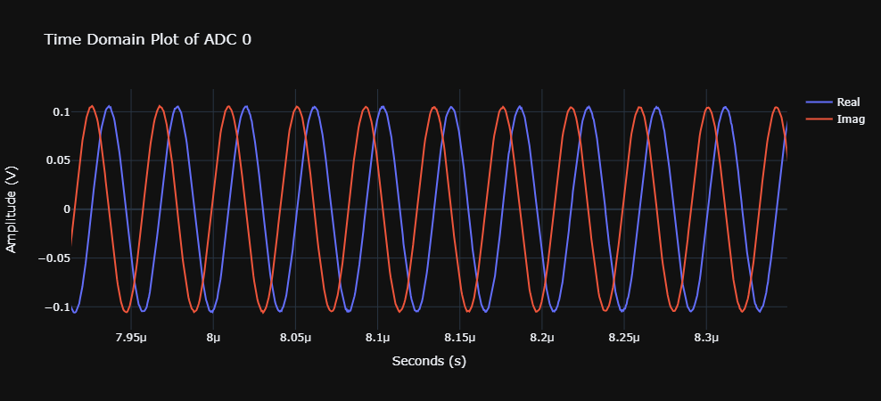

# RF System Package

This package contains a hierarchical radio block design for PYNQ on
RFSoC. The purpose of this hierarchy is to provide the user visualisation
capabilities for the RFSoC's DataConverters (RF-DCs). The RF-DC core already
has its own driver (`xrfdc`), which this design uses.
The image below demonstrates the visualisation capabilities of the hierarchical
radio block design.



The `rfsystem` software package can be added through pip installation.
This will install the package to your system.

```
pip3 install .
```

Copyright (C) 2026 Advanced Micro Devices, Inc.

SPDX-License-Identifier: BSD-3-Clause
